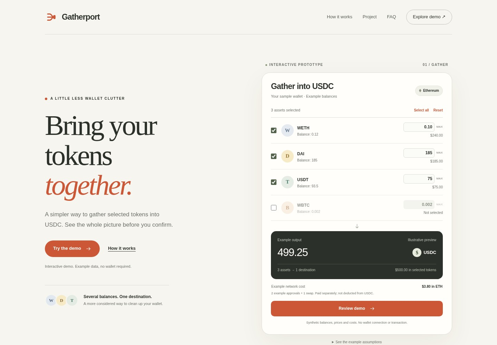

# Gatherport

**Bring your tokens together.**

Gatherport is an independent wallet utility in development. We are building a clearer way to review selected Ethereum token balances and consolidate eligible assets into USDC in the same wallet.

[Explore the demo](https://decentblip.github.io/gatherport-web/) · [Project overview](https://decentblip.github.io/gatherport-web/project.html) · [Product notes](PROJECT.md)



## A simpler wallet workflow

**Choose deliberately.** Select the assets and amounts to gather; keep everything else as it is.

**Review the outcome.** See the destination amount, cost breakdown and permission requirements together.

**Stay in control.** The planned live flow leaves approvals and transaction signing with the wallet owner.

## Current release

**Status: Interactive prototype.**

The current release demonstrates the selection and review experience using synthetic balances, prices and costs. It supports asset selection, editable amounts, balance validation, illustrative outputs, a review dialog and a completion walkthrough.

It does not connect a wallet, read live balances, request market quotes, grant token permissions or submit transactions. No real assets move in the demo.

## Development direction

| Area | Status |
| --- | --- |
| Responsive interface and interactive walkthrough | Available in this repository |
| Live prices, eligible assets and quote validation | Planned |
| Wallet connection and allowance checks | Planned |
| User-signed execution and transaction status | Planned |

The initial live scope is Ethereum with USDC as the destination asset. Supported assets, costs and execution routes will be established during integration and testing.

## Run locally

Open `index.html` in a modern browser. No package installation, build step, wallet or account is needed. The project overview is available in `project.html`.

## Repository layout

```text
index.html       Interactive product website
project.html     Product overview and development scope
README.md        Repository introduction
PROJECT.md       Product and implementation notes
brand/           Original logo and avatar files
previews/        Screenshots of this release
.nojekyll        Static publishing marker
.gitignore       Local-file exclusion rules
```

## Project links

The `SITE_CONFIG` object near the end of `index.html` holds public project URLs. The repository and project-site URLs are configured for `DeCentBlip/gatherport-web`. The X and Telegram links remain hidden until their verified public URLs are supplied.

Only public URLs belong in this object. Credentials, private keys and account recovery information must never be committed to this repository.

## Demo data and privacy

All numerical examples are illustrative, not prices or fees available for execution. Network costs are shown separately from the example USDC output. The assumptions are disclosed beside the demo.

The demo runs in the browser and does not use analytics, cookies, local storage, wallet connections or live-data requests. The hosting platform can process routine access information when serving the website.

## Feedback

Use this repository's [issue tracker](https://github.com/DeCentBlip/gatherport-web/issues) for reproducible interface bugs and product feedback. Do not post personal information, credentials or wallet secrets.
